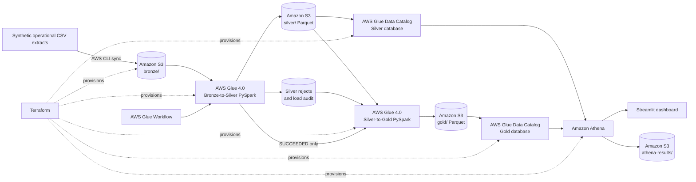
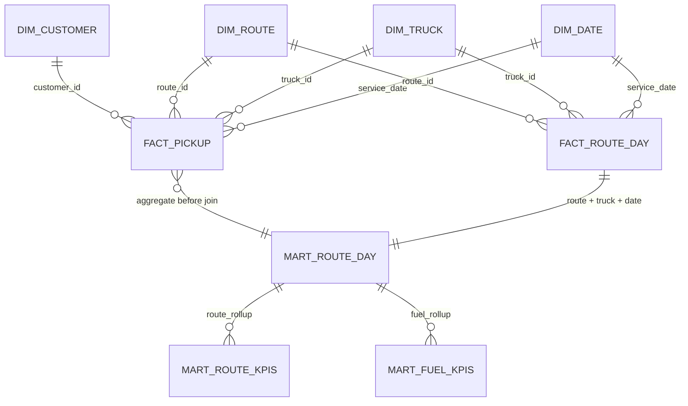
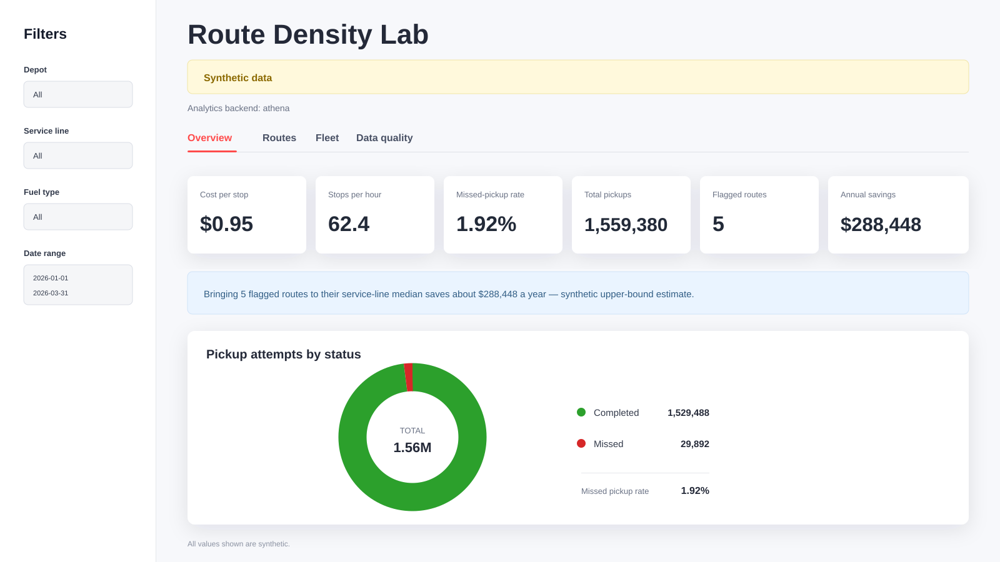

# Waste Management Route Density Analysis

[](https://aws.amazon.com/)
[](https://www.python.org/)
[](https://www.terraform.io/)
[](#testing-and-quality-gates)

An AWS medallion data platform for finding inefficient waste-collection routes, explaining the drivers of route cost, and estimating the savings available when high-cost routes improve toward the median of their own service line.

> **Data notice:** every source record, KPI, chart, and monetary value in this repository is synthetic. The project demonstrates engineering and analytical patterns; it does not represent a real operator.

## Problem statement

Waste-collection operators need to identify routes that consume excessive labour, fuel, and maintenance resources without penalizing legitimately different operating models. A residential route and a commercial route should not be compared against one global benchmark, and route-day costs must not be joined directly to individual pickup rows because doing so multiplies costs by the number of stops.

This project answers four operational questions:

1. Which routes have unusually low completed stops per hour?
2. Which routes have unusually high cost per completed stop within their service line?
3. How much annual savings could be available if flagged routes reached their service-line median cost per stop?
4. Are CNG and diesel trucks materially different in fuel and maintenance cost per kilometre?

The solution preserves each business process at its natural grain, validates every source row, and exposes trusted additive marts and sum-over-sum KPIs through Amazon Athena and Streamlit.

## AWS architecture



### End-to-end flow

| Stage | AWS component | Responsibility | Output |
|---|---|---|---|
| Provision | Terraform | Creates storage, IAM, Glue jobs, Catalog tables, Athena workgroup, and workflow | Repeatable AWS environment |
| Land | Amazon S3 Bronze prefix | Retains immutable CSV extracts exactly as received | Replayable raw source |
| Validate | AWS Glue 4.0 Job 1 | Deduplicates, casts, validates, rejects, and reconciles | Typed Silver Parquet, rejects, audit |
| Model | AWS Glue 4.0 Job 2 | Builds dimensions, facts, additive marts, and KPI marts | Query-ready Gold Parquet |
| Catalog | AWS Glue Data Catalog | Registers seven Silver and ten Gold schemas explicitly | Stable table contracts without crawlers |
| Query | Amazon Athena | Executes serverless SQL against Catalog-backed Parquet | Compact dashboard result sets |
| Serve | Streamlit | Applies filters and presents operational, route, fleet, and quality views | Decision-support dashboard |

The current Terraform creates one encrypted, private project bucket with isolated `bronze/`, `silver/`, `gold/`, `scripts/`, and `athena-results/` prefixes. Bucket names include the AWS account ID and region to remain globally unique. Athena results expire after seven days.

### Orchestration

Terraform creates an AWS Glue Workflow containing both jobs. Its start trigger is deliberately disabled so infrastructure deployment cannot unexpectedly execute ETL. When execution is authorized, Bronze-to-Silver must succeed before Silver-to-Gold can start. The deployment script also enforces this order and stops on the first failed job.

## Medallion layers

### Bronze — immutable source

Bronze holds the synthetic CSV extracts for trucks, routes, customers, pickup attempts, and route-day operations. Values are ingested as received and are never corrected in place. Reprocessing starts from the same immutable source.

### Silver — validated operational data

The first Glue job reads Bronze as strings, removes deterministic duplicates, parses contract types, applies ordered quality rules, and separates trusted rows from rejected rows.

Silver publishes seven Parquet datasets:

- `trucks`, `routes`, `customers`, `pickups`, and `route_days`
- `rejects`, containing the source, first failed rule, raw record, and load timestamp
- `load_audit`, containing raw, duplicate, rejected, and accepted row counts

Every source must satisfy:

```text
Bronze rows = Silver rows + rejected rows + duplicates removed
```

### Gold — dimensional analytics

The second Glue job converts trusted Silver data into conformed dimensions, natural-grain facts, and decision-ready marts. Route-day costs never touch pickup-grain rows. Pickup activity is aggregated to route + truck + service date before it is joined to operating cost.

## Data model



| Gold object | Grain | Purpose |
|---|---|---|
| `dim_truck` | One truck | Fuel type, model year, body type, and depot context |
| `dim_route` | One route | Depot, service line, and planned stops |
| `dim_customer` | One customer | Route ownership, segment, service day, and revenue context |
| `dim_date` | One calendar date | Complete date spine with weekday, ISO week, month, and weekend flag |
| `fact_pickup` | One pickup attempt | Completed/missed status and collected tonnage |
| `fact_route_day` | One route + truck + date | Hours, distance, labour, fuel, maintenance, and total cost |
| `mart_route_day` | One route + truck + date | Additive pickup activity joined safely to route-day operations |
| `mart_rejects_summary` | One source + rule | Rejected-row counts by failure reason |
| `mart_route_kpis` | One route | Route totals, service-line benchmarks, flags, and savings estimate |
| `mart_fuel_kpis` | One fuel type | Fuel, maintenance, and vehicle cost per kilometre |

### Grain-safe KPI design

Ratios are calculated from aggregated numerators and denominators rather than averaged row-level ratios:

```text
stops_per_hour      = Σ completed_stops / Σ shift_hours
tons_per_hour       = Σ tons / Σ shift_hours
missed_rate         = Σ missed_stops / Σ pickup_attempts
cost_per_stop       = Σ total_cost / Σ completed_stops
vehicle_cost_per_km = (Σ fuel_cost + Σ maint_cost) / Σ km_driven
```

Route percentiles and median cost per stop are calculated within `service_line`, preventing residential and commercial routes from being benchmarked as though they were operationally identical.

## Data quality

Quality controls are part of the pipeline rather than a dashboard afterthought:

1. **Schema validation:** required fields and Athena-compatible date, timestamp, numeric, and Boolean types are enforced.
2. **Deterministic deduplication:** duplicate business keys are removed predictably and counted.
3. **Ordered business rules:** invalid status, tonnage, foreign keys, shift timing, and non-positive route-day measures are evaluated in fixed precedence order.
4. **Quarantine:** bad records are written to `silver/rejects/`; no invalid row disappears silently.
5. **Reconciliation:** every source is balanced using the Bronze-to-Silver accounting equation.
6. **Referential integrity:** customer, route, truck, and date keys are checked across Silver and Gold.
7. **Grain controls:** pickup IDs and route-day compound keys are tested for uniqueness.
8. **Post-deployment QA:** Athena checks confirm non-empty marts, unique fact grains, valid joins, and KPI invariants.

The Data Quality dashboard tab exposes reconciliation status, reject counts by rule, and sample rejected records for investigation.

## Streamlit dashboard



The dashboard queries Gold through Amazon Athena and provides four views:

- **Overview:** cost per stop, stops per hour, missed rate, total pickups, flagged routes, annual savings, and completed-versus-missed donut chart.
- **Routes:** highest-cost routes, service-line median comparison, flag reason, and route-level detail.
- **Fleet:** CNG-versus-diesel fuel, maintenance, and total vehicle cost per kilometre.
- **Data quality:** reconciled sources, reject summaries, and representative rejected records.

All displayed values are synthetic. The image above represents the default unfiltered dataset.

## AWS deployment

### Prerequisites

- AWS credentials with permission to manage S3, IAM, Glue, Athena, and CloudWatch Logs
- AWS CLI
- Terraform 1.5 or newer
- Python 3.11 with dependencies from `requirements.txt`

### Provision and execute

Review the plan before creating resources:

```bash
terraform -chdir=infra init
terraform -chdir=infra plan -var='project=route-lab' -var='aws_region=eu-west-1'
```

Deploy, upload Bronze, execute both Glue jobs in order, and run AWS QA:

```bash
PROJECT=route-lab AWS_REGION=eu-west-1 make deploy
```

The deployment leaves resources running for inspection. It does not destroy infrastructure automatically.

### Connect Streamlit to Athena

```bash
ANALYTICS_BACKEND=athena \
AWS_REGION=eu-west-1 \
AWS_SILVER_DATABASE=route_lab_silver \
AWS_GOLD_DATABASE=route_lab_gold \
ATHENA_WORKGROUP=route-lab \
streamlit run app.py
```

### Destroy managed resources

```bash
PROJECT=route-lab AWS_REGION=eu-west-1 make destroy
```

The destroy script targets only resources recorded in this project’s Terraform state.

## Security and operational controls

- S3 public access is blocked at the bucket level.
- Server-side encryption with Amazon S3-managed keys is enabled.
- Glue assumes a dedicated IAM role and writes execution logs to CloudWatch Logs.
- Athena enforces its workgroup output location and encrypts query results.
- Glue schemas are declared in Terraform; crawlers cannot introduce schema drift.
- The workflow is dormant after deployment and has no schedule.
- Terraform state, generated data, credentials, and environment files are excluded from Git.

## Testing and quality gates

```bash
python -m pytest -q
python qa/run_qa.py
terraform -chdir=infra fmt -check
terraform -chdir=infra validate
```

The automated suite covers deterministic generation, rule precedence, row reconciliation, natural fact grains, sum-over-sum KPIs, Catalog coverage, Glue dependency ordering, Athena-backed dashboard behavior, and Streamlit compatibility.

## Repository structure

```text
glue/                 AWS Glue 4.0 PySpark jobs
infra/                Terraform for S3, IAM, Glue, Catalog, Athena, and workflow
scripts/              AWS deployment, validation, and teardown automation
sql/                  Dimension, fact, and mart reference SQL
specs/                Business goal, data contract, KPI definitions, acceptance criteria
tests/                Unit, integration, infrastructure, and dashboard tests
analytics.py          Athena-backed dashboard data adapter
app.py                Streamlit dashboard
```

## License

This repository is intended as an educational and portfolio project. Add an explicit license before redistributing it as a reusable software package.
